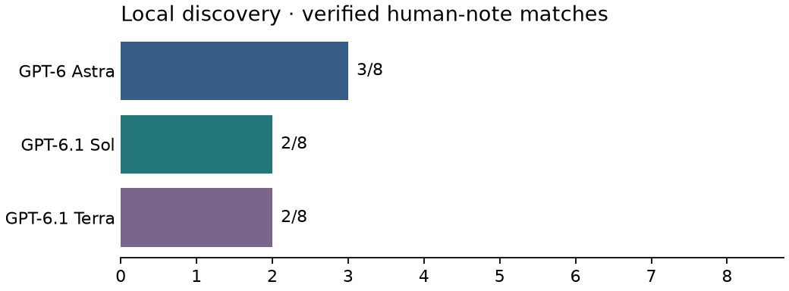
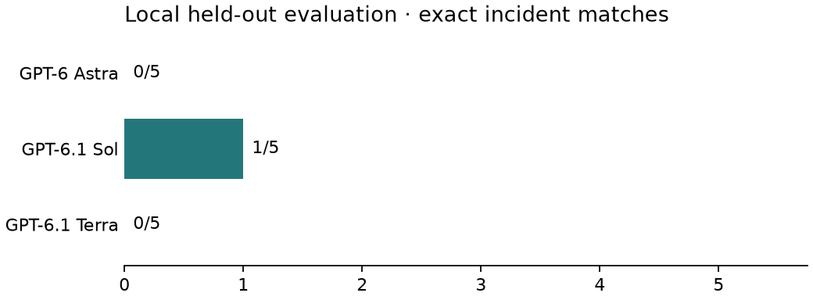

# EvalScout

> **AUTHOR INTRODUCTION PLACEHOLDER**
>
> Replace this block with your personally written introductory paragraph.

EvalScout measures whether an agent can investigate support conversations,
find meaningful failures, and turn those insights into executable tests that
work on new traces.

## Demo

1. Read the [task](benchmark/workspace/TASK.md),
   [retail policy](benchmark/workspace/retail_policy.md), and
   [submission contract](benchmark/workspace/CONTRACT.md).
2. Open the local Streamlit dashboard using the
   [dashboard instructions](dashboard/README.md). The original author
   workspace has the full annotated dataset and model results.
3. See [local model results](benchmark/LOCAL_RESULTS.md) for the original
   Astra, Sol, and Terra experiment. Results from Valkyrie are tracked
   separately in [SUBMISSION_CHECKLIST.md](SUBMISSION_CHECKLIST.md).




## Reproduce a Valkyrie run

The service was generated with the official
[create-benchmark-service starter](https://github.com/vals-ai/create-benchmark-service).
Install Docker, uv, and the [Valkyrie CLI](https://docs.valkyrie.vals.ai/).
Use the official [conversion guide](https://docs.valkyrie.vals.ai/benchmarks/convert-a-benchmark)
for tunnel and provider setup. The private evaluation bundle must be
provided by the organizer separately. It contains `test.jsonl` and
`grading_reference.json`. A rejected or incomplete run does not establish
an integration result.

```sh
docker pull --platform linux/amd64 python:3.12-slim
cd evalscout-benchmark-service
uv sync
EVALSCOUT_TEST_DOCKER=1 uv run pytest -q
```

Set `EVALSCOUT_PRIVATE` to the private bundle directory. Start the service
with `AUTH_REQUIRED=true` and `EVALSCOUT_SERVICE_TOKEN` supplied in its
environment. The service expects the exact `Bearer TOKEN` header value.
Save that header value as a Valkyrie organization secret and register the
tunnel URL using `valkyrie benchmark service set evalscout URL --auth-secret
SECRET_REFERENCE`. Store model and sandbox-provider credentials in Valkyrie.

```sh
uv run uvicorn main:app --host 127.0.0.1 --port 8001

valkyrie run start --benchmark evalscout --dataset default \
  --task-ids evalscout-retail --agent codex-v1.0.0 \
  --model openai/gpt-6.1-sol --provider modal --concurrency 1 \
  --secret OPENAI_API_KEY openai-key --connect
```

Use a second terminal for the run and keep the service and tunnel running.
Use `valkyrie run results`, `valkyrie run errors`, and
`valkyrie run outputs` to save the results locally.

## Reproduce the dashboard

Clone the pinned upstream τ-bench archive into `data_sources/tau-bench`.
Then install Streamlit as described in [dashboard/README.md](dashboard/README.md).
A clean submission checkout can browse the upstream archive. Full experiment
overlays and the annotation workflow require the author's local artifacts,
which contain private data and stay out of Git.

See [methodology, provenance, and limitations](benchmark/METHODOLOGY.md) for
the frozen task and grading rules. The source attribution and MIT terms are
in [SIERRA_LICENSE](benchmark/SIERRA_LICENSE).
